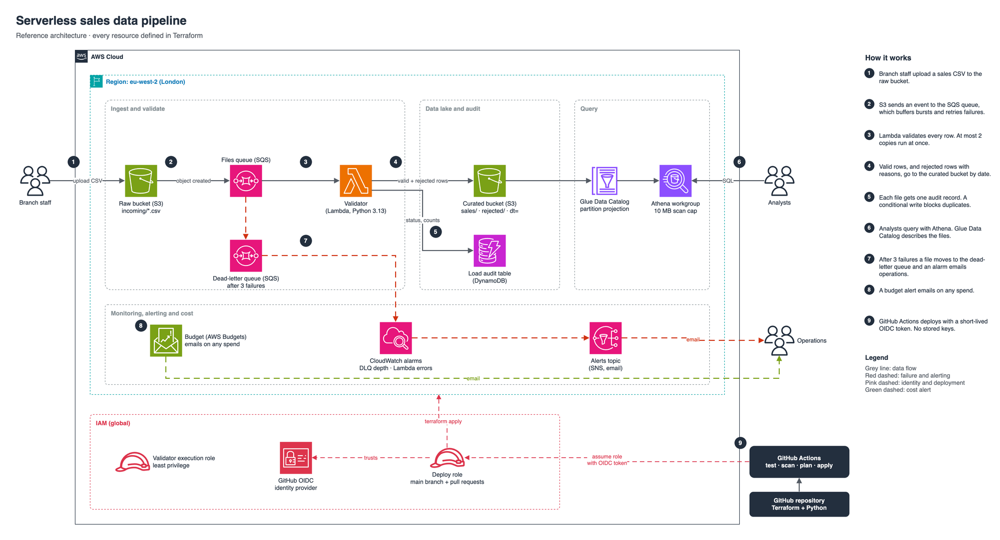

# Serverless sales data pipeline on AWS

[](https://github.com/gumagatsby/aws-serverless-sales-pipeline/actions/workflows/ci.yml)

*Deploys are paused. Since 18 October 2026 AWS has refused Lambda calls on this account, so the plan step fails; tests, format, validate and Checkov still pass. I'm currently working on it with AWS.*

Branches upload a weekly sales CSV. Within seconds every row is checked, good rows land in a queryable data lake, bad rows are kept with the reason they failed, and every file gets an audit record. Failures alert someone by email. The whole stack is Terraform, deployed by GitHub Actions with no stored AWS keys, and it is designed to run at zero cost.



Editable source: [`docs/architecture.drawio`](docs/architecture.drawio) (open in [diagrams.net](https://app.diagrams.net)). A portrait version for social posts is in [`docs/linkedin-architecture.drawio`](docs/linkedin-architecture.drawio).

## The problem it solves

A retailer's branches each send a sales spreadsheet. Head office combines them by hand, errors surface only after reports have gone out, and nobody can say which file a number came from. This pipeline replaces the manual step with one that:

- Validates every row against explicit rules (date, branch, SKU format, units, revenue, cost, duplicates).
- Never silently drops data. Rejected rows are stored with every reason they failed, so the branch can fix and resend.
- Records an audit trail per file: status, rows loaded, rows rejected, start and finish time.
- Is safe to re-run. Uploading the same file twice does not double-count sales.
- Tells a person when something breaks rather than failing quietly.

## How it works

| Step | Service | Why this choice |
|---|---|---|
| 1. File lands in `incoming/` | S3 (raw bucket) | Cheap, durable landing zone; raw files expire after 30 days |
| 2. Event is queued | SQS + dead-letter queue | Buffers bursts, retries failures 3 times, then parks the file for investigation instead of losing it |
| 3. Rows validated | Lambda (Python 3.13, arm64) | Pay per run, no servers; Graviton is cheaper per second |
| 4. Output written | S3 (curated bucket), partitioned by `dt=` | Query engines read only the days they need |
| 5. File audited | DynamoDB (on-demand) | A conditional write gives idempotency and the audit record in one step |
| 6. Data queried | Glue Data Catalog + Athena | SQL over S3 without a database server; partition projection removes the need for crawlers |
| 7. Failures alerted | CloudWatch alarms + SNS email | Dead-letter queue depth and Lambda errors |
| 8. Spend watched | AWS Budgets | Emails on any spend at all |

More detail: [design decisions and trade-offs](docs/decisions.md) · [runbook](docs/runbook.md)

## Security

- Each S3 bucket blocks public access, encrypts at rest and refuses non-TLS requests.
- The Lambda role can only read `incoming/`, write the curated bucket, and touch its own queue, table and log group.
- GitHub Actions authenticates to AWS with OIDC. There are no long-lived access keys anywhere, and only this repository's `main` branch and pull requests can assume the deploy role.
- Every change is scanned by [Checkov](https://www.checkov.io/). Checks skipped on purpose are listed with reasons in [`.checkov.yml`](.checkov.yml).

## Cost

Designed to cost nothing at portfolio volumes. Lambda, SQS, DynamoDB on-demand, SNS email, CloudWatch alarms and Budgets notifications sit inside AWS's free allowances at this scale. Things that would add a monthly charge were avoided on purpose: customer-managed KMS keys, NAT gateways, VPC endpoints, Glue crawlers and point-in-time recovery. Athena has a 10 MB per-query scan cap, and raw files and query results expire automatically. A budget alert fires on the first cent.

## Try it

```bash
aws s3 cp sample-data/weekly-sales-w41.csv s3://$(terraform -chdir=terraform output -raw raw_bucket)/incoming/weekly-sales-w41.csv
```

The sample has 10 rows, 5 of them deliberately bad. A few seconds later:

```bash
# Audit record for the file
aws dynamodb scan --table-name ssp-load-audit

# Rows by branch and day, and why rows were rejected (saved queries in the ssp-sales workgroup)
#   daily-margin-by-branch
#   rejection-reasons
```

## Deploy

Prerequisites: Terraform 1.10 or later, an AWS account, the GitHub CLI for the bootstrap step, and Python 3.13 to run the tests locally.

1. Bootstrap once (state bucket and GitHub deploy role):
   ```bash
   cd terraform/bootstrap
   terraform init
   terraform apply -var github_repo=<owner>/<repo> \
     -var github_subject_prefix="$(gh api repos/<owner>/<repo>/actions/oidc/customization/sub --jq .sub_claim_prefix)"
   ```
   GitHub's OIDC subject includes the owner and repo IDs, so the role trusts this exact repository even if the name is later reused.
2. Add repository secrets in GitHub: `AWS_DEPLOY_ROLE_ARN`, `TF_STATE_BUCKET` (both from the bootstrap outputs) and `ALERT_EMAIL`.
3. Push to `main`. The pipeline runs tests, format and validate, Checkov, then plan and apply. Pull requests stop at plan.
4. Confirm the SNS subscription email that AWS sends.

To run it locally instead:

```bash
cd terraform
terraform init -backend-config="bucket=<state bucket>" -backend-config="region=eu-west-2"
terraform apply -var alert_email=<you@example.com>
```

**Tear down:** `terraform destroy` in `terraform/`, then in `terraform/bootstrap/`.

## Repository layout

```
src/validator/      Lambda code: rules.py (pure validation) and handler.py (AWS wiring)
tests/              Unit tests for every validation rule
terraform/          Main stack: storage, ingest, catalog, monitoring
terraform/bootstrap State bucket and GitHub OIDC deploy role
docs/               Architecture diagrams (draw.io + PNG), decisions, runbook
.github/workflows/  CI/CD
```
